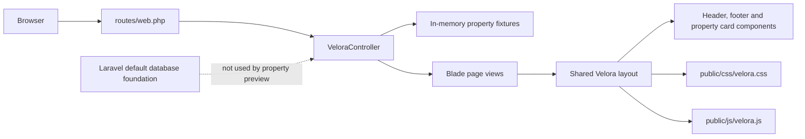

# VELORA ESTATES

<p align="center">
  <strong>Exceptional Homes. Remarkable Lives.</strong><br>
  A refined real-estate discovery interface built as a Laravel frontend preview.
</p>

<p align="center">
  
  
  
  
</p>

<p align="center">
  <a href="#overview">Overview</a> ·
  <a href="#showcase">Showcase</a> ·
  <a href="#technology-stack">Stack</a> ·
  <a href="#getting-started">Setup</a> ·
  <a href="#roadmap">Roadmap</a>
</p>

> **Current status** — Frontend preview / visual approval phase. Property records, photography, people, testimonials and business metrics shown in the interface are illustrative fixtures, not verified production data.

## Overview

Velora Estates presents a quiet-luxury property browsing experience for exceptional homes and destinations. The current implementation focuses on the editorial presentation layer: cinematic property imagery, a restrained ivory-and-charcoal palette, warm gold actions, responsive layouts and lightweight browser interactions.

The product currently includes three public Blade-rendered views:

| Route | Verified implementation |
| --- | --- |
| `/` | Homepage with hero, property search preview, featured cards, service story, demo agent profiles, demo testimonial carousel and contact enquiry preview. |
| `/properties` | Fixture-driven catalog with location, property-type, price and bedroom controls, client-side filtering, sorting, responsive filter drawer and property cards. |
| `/properties/{slug}` | Property detail preview with gallery thumbnails, lightbox, save/share affordances, specifications, features, floor-plan presentation, tour preview and related properties. |

There is no verified deployment URL or live demo link in this repository, so none is advertised here.

## Showcase

The UI is organized as a small editorial product system rather than a collection of isolated screens.

### Homepage

- Full-bleed hero treatment with the VELORA ESTATES wordmark and private-tour CTA.
- Search form that passes location, type, maximum price and bedroom values to the catalog route.
- Featured property cards with responsive layout, status labels and browser-local favorites.
- About/service narrative, illustrative agent profiles and a demo testimonial carousel.
- Contact form with client-side validation and an explicit preview-mode non-persistence notice.
- Skip link, semantic landmarks, labeled controls and reduced-motion CSS handling.

### Property catalog

- Responsive grid of fixture-driven property cards.
- Location, type, maximum price and bedroom filtering performed in the browser.
- Sort controls for price and area; the remaining presentation options are still preview UI.
- Mobile filter drawer, empty state and responsive card layout.

### Property detail

- Thumbnail gallery with previous/next controls, keyboard navigation and lightbox expansion.
- Save state stored in `localStorage` under a preview-only key.
- Native share API with clipboard fallback when supported by the browser.
- Feature list, floor-plan illustration, agent panel, tour-request preview and related-property cards.

### Visual assets

No committed screenshot or local property image asset is present in the source tree. The interface references remote Unsplash images marked as illustrative demo photography in the templates and documented in [the image asset manifest](docs/IMAGE_ASSET_MANIFEST.md). A production release still requires approved, self-hosted assets, usage verification and factual alt text.

## Core features and boundaries

| Area | Status | Evidence in source |
| --- | --- | --- |
| Property discovery | Implemented as preview | `VeloraController` supplies an in-memory fixture array to Blade views. |
| Property cards and detail pages | Implemented as preview | Reusable `property-card` component plus `properties` and `property` views. |
| Search and filtering | Partial | Location, type, maximum price and bedrooms work client-side; amenity controls are present but not applied by the current filter logic. |
| Property gallery | Implemented as preview | Thumbnail switching, lightbox, counter and keyboard controls in `public/js/velora.js`. |
| Saved properties | Partial | Browser `localStorage` only; no account or server persistence. |
| Contact and tour forms | Partial | Browser validation and preview feedback only; no storage, email delivery or appointment confirmation. |
| User accounts | Not implemented | The default Laravel `User` model and migrations remain, but no public authentication flow is wired. |
| Agent management | Not implemented | Agent content is illustrative presentation copy; there is no agent model or management workflow. |
| Admin dashboard | Not implemented | No dashboard routes, views, policies or management UI were found. |
| Location and maps | Not implemented | No map provider, map SDK, API integration or location view is present. |
| Responsive design | Implemented in CSS | Breakpoints cover desktop, tablet and mobile layouts, including the mobile navigation drawer. |

## Technology stack

| Layer | Verified technology | Purpose |
| --- | --- | --- |
| Backend | Laravel Framework 13.35.0 | Application bootstrap, routing, Blade rendering and framework services. |
| Runtime | PHP 8.3.16 locally; `^8.3` in `composer.json` | Server-side runtime. |
| Frontend rendering | Blade templates | Shared layout, header/footer partials, property cards and page views. |
| Interaction layer | Vanilla JavaScript | Navigation, filters, sorting, gallery, lightbox, forms, favorites and preview toasts. |
| Styling | Hand-authored CSS | `public/css/velora.css` contains the visual system, responsive rules and accessibility states. |
| Data source | PHP fixture array | `app/Http/Controllers/VeloraController.php`; there is no property Eloquent model yet. |
| Database foundation | SQLite configuration plus Laravel default migrations | Users, sessions, cache and jobs foundation only; no property or inquiry tables. |
| Tooling | Composer, Vite configuration, npm scripts | PHP dependency management and the project’s standard frontend build scaffold. |

The Velora pages currently load `public/css/velora.css` and `public/js/velora.js` directly. The Vite entry points in `resources/` remain part of the Laravel scaffold and are not the assets used by the current Velora layout.

## System architecture



This is a server-rendered Laravel preview with a small client-side interaction layer. The current property catalog does not query a database, call a private API or use a map service.

## Project structure

```text
app/
├── Http/Controllers/VeloraController.php   # Public preview data and page actions
├── Models/User.php                          # Default Laravel user model
└── Providers/AppServiceProvider.php
database/
├── migrations/                              # Default Laravel foundation tables
├── factories/UserFactory.php
└── seeders/DatabaseSeeder.php
docs/
├── DESIGN_REFERENCE_ANALYSIS.md
└── IMAGE_ASSET_MANIFEST.md
public/
├── css/velora.css                           # Velora visual system
└── js/velora.js                             # Preview interactions
resources/views/
├── layouts/velora.blade.php
├── components/                              # Shared Blade partials
├── home.blade.php
├── properties.blade.php
└── property.blade.php
routes/web.php                               # Three public preview routes
tests/
├── Feature/ExampleTest.php
└── Unit/ExampleTest.php
```

Generated dependencies, caches, local environment files and build output are intentionally omitted from this overview.

## Getting started

### Prerequisites

- PHP 8.3 or later
- Composer
- Node.js and npm only when running the configured Vite build

### Install locally

From the project root:

```bash
composer install
```

Create a local `.env` file. Do not commit it or copy secrets into documentation. The following values are safe local-preview examples:

```dotenv
APP_NAME="Velora Estates"
APP_ENV=local
APP_DEBUG=true
APP_URL=http://127.0.0.1:8000

DB_CONNECTION=sqlite
DB_DATABASE=database/database.sqlite
SESSION_DRIVER=file
CACHE_STORE=file
QUEUE_CONNECTION=sync
MAIL_MAILER=log
```

Generate the application key and prepare the default Laravel database foundation:

```bash
php artisan key:generate
php artisan migrate
```

Start the local server:

```bash
php artisan serve --host=127.0.0.1 --port=8000
```

Open `http://127.0.0.1:8000` and use the routes listed in [Overview](#overview).

### Frontend build

The repository includes a Vite configuration. Install the JavaScript packages and run the build when working on the scaffolded `resources/` entry points:

```bash
npm install
npm run build
```

The current Velora preview serves its main CSS and JavaScript from `public/`, so a Vite build is not required to render the three documented pages.

### Verification commands

```bash
php artisan view:cache --no-interaction
php artisan test --compact
node --check public/js/velora.js
```

## Roadmap

| Status | Scope |
| --- | --- |
| Completed | Public Blade preview routes, shared layout/components, responsive visual system, fixture catalog, detail gallery, client-side preview interactions and source documentation. |
| In progress | No in-progress production feature is evidenced in the current source. The project remains at the visual approval stage. |
| Planned | Replace fixtures with verified property data and Eloquent models; add inquiry/tour persistence and mail delivery; implement authentication, authorization, favorites and agent/admin workflows; add map integration; replace demo photography and copy; complete browser QA and production hardening. |

## Security, quality and production notes

- No credentials, tokens or operational contact details are published in this README.
- Local environment files are ignored by `.gitignore`.
- Forms explicitly report that they are preview-only and do not store or email submissions.
- Remote photography, demo profiles, testimonials and interface metrics must be reviewed and replaced before production use.
- The current source does not establish production readiness, listing availability, business performance, licensed imagery, verified staff identity or completed test coverage.
- There is no license file or verified repository remote in this checkout, so no license or repository link is claimed here.

### Local verification snapshot

The following checks were run against the current checkout on 2026-10-14:

- `php artisan view:cache --no-interaction` — passed.
- `php artisan test --compact` — passed: 2 tests, 2 assertions.
- `node --check public/js/velora.js` — passed.
- `/`, `/properties` and `/properties/aegean-horizon-villa` — returned HTTP 200 from the local server.
- `npm run build` — not completed in this checkout because `node_modules` and the local Vite executable are not installed.
- Browser screenshot capture and pixel comparison — not included; no committed screenshot asset or configured browser runner was found.

## Further reading

- [Velora master implementation report](VELORA_MASTER_REPORT.md)
- [Design reference analysis](docs/DESIGN_REFERENCE_ANALYSIS.md)
- [Image asset manifest](docs/IMAGE_ASSET_MANIFEST.md)

<p align="center">
  <strong>VELORA ESTATES</strong><br>
  <em>Discover a More Refined Way to Live.</em><br><br>
  <a href="#velora-estates">Back to top</a>
</p>
